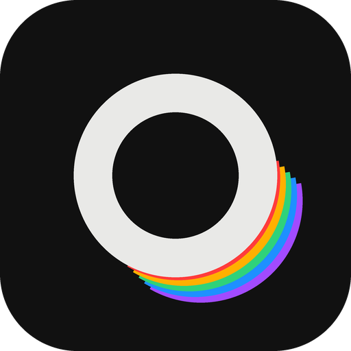
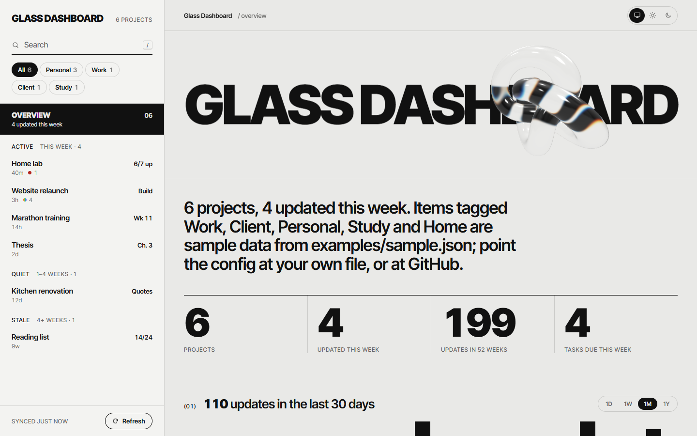
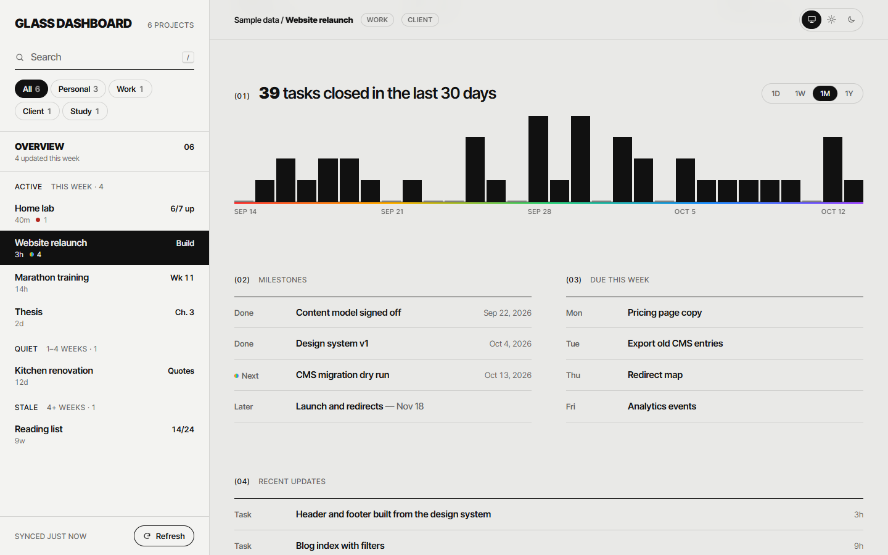
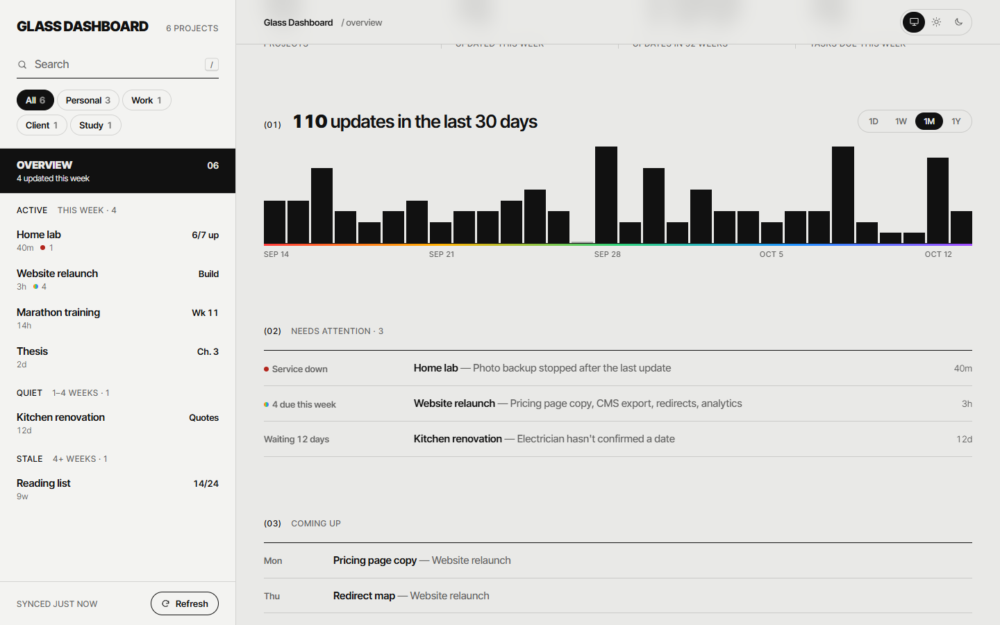
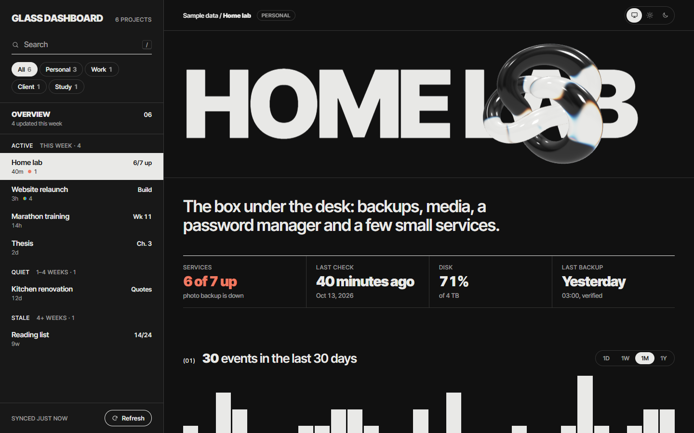
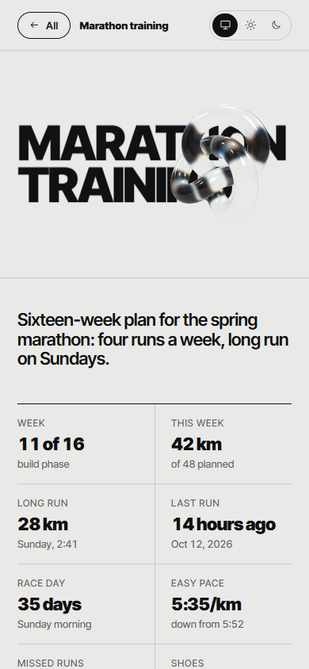

<p align="center"></p>

<h1 align="center">Glass Dashboard</h1>

<p align="center"><b>One calm page for everything you're keeping track of, running on your own machine.</b></p>

<p align="center">
  <a href="https://github.com/EY4O/glass-dashboard/blob/main/LICENSE"></a>
  <a href="https://github.com/EY4O/glass-dashboard/commits/main"></a>
  <a href="https://ko-fi.com/looneth"></a>
</p>

Glass Dashboard is a template for building your own dashboard: your GitHub repos, a client project, a training plan, a home lab, or all of them at once. Every item gets a rail entry and a full page with its facts, an activity chart and its lists and links, while an overview sums up what moved and what needs you. Data comes from small **adapters**: GitHub and hand-written JSON ship ready, and a new source is one short file. It's a single Node script with no dependencies that serves the page on `localhost`.



---

## ✨ Key Features

- 🧭 **Rail and sheet** — every item ranked by when it last moved (Active, Quiet, Stale), with the selected one filling the page.
- 🔌 **Pluggable sources** — mix GitHub repos and JSON files in one dashboard; write an adapter for anything else in a few lines.
- 🐙 **GitHub built in** — versions from manifest files, releases with download counts, unreleased commits, CI state, open issues and PRs, and store links found in each README.
- 📈 **Activity over 1D, 1W, 1M or 1Y** — real timestamps counted by hour, six hours, day or week on your own clock.
- 🚩 **Needs attention** — failing checks, waiting work and quiet items collected on the overview.
- 🌗 **Light and dark** — follows your system, or pick one; the choice is remembered.
- 🔮 **The glass band** — each item's name in heavy type, refracted through a rotating glass knot (WebGL, with a plain fallback).
- 🔒 **Local and read-only** — listens on `127.0.0.1` only, refuses other sites, and never writes anywhere.

## 📸 Screenshots

| | |
|---|---|
|  **Item page** — activity, milestones and what's due, side by side |  **Overview** — activity across everything and what needs you |
|  **Dark mode** — a failing service shows in red on the rail and in its facts |  **Phone** — the rail becomes a list, and each item opens full screen |

<sub>Screenshots use the sample data in `examples/sample.json`.</sub>

---

## 📦 Installation

### Option 1: **Use this template** (Recommended)

1. Click **Use this template → Create a new repository** at the top of this page.
2. Clone your new repository.
3. Edit `dashboard.config.json` (see **Getting Started**).

### Option 2: **Clone**

```bash
git clone https://github.com/EY4O/glass-dashboard.git my-dashboard
```

### Option 3: **Download ZIP**

Download the repository as a ZIP from GitHub and unzip it anywhere.

There's nothing to install: it needs [Node.js](https://nodejs.org) 20 or newer and has no packages. The GitHub source also needs the [GitHub CLI](https://cli.github.com), signed in with `gh auth login`.

## 🚀 Getting Started

1. Run `npm start` (or `node server.mjs`, or double-click **Open Dashboard.bat** on Windows) and open <http://localhost:4400>. You'll see the sample dashboard.
2. Open `dashboard.config.json` and set `title` and `noun` (what you call your items, like `["project", "projects"]`).
3. Replace the `sources` list with your own. For your GitHub repos:
   ```json
   "sources": [{ "adapter": "github", "options": { "user": "@me" } }]
   ```
   For anything else, copy `examples/sample.json`, edit it, and point a `json` source at it.
4. Restart the server and press **Refresh**. Your items appear in the rail, and the overview fills in.

---

## 📖 How It Works

<details>
<summary><b>⚙️ The config file</b></summary>

`dashboard.config.json` sits next to `server.mjs`. Use another file with `node server.mjs --config path/to/file.json` or the `DASHBOARD_CONFIG` environment variable; `PORT` overrides the port.

| Key | Meaning |
|---|---|
| `title` | The name on the rail and the overview's glass band |
| `noun` | Singular and plural for your items, e.g. `["repo", "repos"]` |
| `port` | Defaults to 4400 |
| `cacheMinutes` | How long a source's data is reused before it's fetched again (default 5; **Refresh** always fetches) |
| `sources` | A list of `{ "adapter": "…", "label": "…", "options": { … } }`, loaded in order and merged |

Examples are in `examples/`: `github.config.json` (your repos) and `mixed.config.json` (GitHub plus a JSON file in one dashboard).
</details>

<details>
<summary><b>🐙 The GitHub source</b></summary>

Options: `{ "user": "@me" }` for your own repos (public and private), `{ "user": "octocat" }` for someone's public repos, `{ "org": "name" }` for an organisation, or `{ "repos": ["owner/name", …] }` for a fixed list. `includeForks` and `includeArchived` default to `true`.

- **Version** comes from `manifest.json`, `package.json`, `pyproject.toml`, `Cargo.toml`, a `.csproj`, `project.godot` or `app.json`, then the latest git tag. The item page names the file it came from.
- **Unreleased** counts commits since the latest release or tag. Older than a year shows as a floor, like `12+`.
- **Downloads** are GitHub's counts for files attached to releases. Store installs and the automatic source-code zips aren't included, and the page says so.
- **Links** are the repo, its homepage, and store or registry links found in the README (Chrome Web Store, Edge Add-ons, Firefox Add-ons, Comfy Registry, npm, PyPI, VS Code Marketplace, itch.io, Steam, Google Play, App Store, GitHub Pages).
- Everything goes through the GitHub CLI, so your token stays inside `gh` and never reaches the browser.
</details>

<details>
<summary><b>📝 The JSON source</b></summary>

Options: `{ "file": "data/items.json" }`, relative to the config file. The file holds `{ "items": [ … ], "overview": { … } }`. Each item can have a name, description, tags, a short label for the rail, marks, facts, activity timestamps, attention notes, sections and links. `examples/sample.json` uses all of them, and **[docs/ADAPTERS.md](docs/ADAPTERS.md)** describes every field.

Dates can be absolute (`"2026-10-12T14:00:00Z"`) or relative to now (`"-3h"`, `"-2d"`, `"-1w"`), which keeps examples from going stale. The file is read again on every load, so edits show up when you press **Refresh**.
</details>

<details>
<summary><b>🔌 Writing an adapter</b></summary>

An adapter is a file in `adapters/` that exports `{ list(options, ctx), detail?(id, options, ctx), ttlMinutes? }`. `list` returns the items (and optional overview stats, sections and a sentence); `detail`, if present, is called when an item is opened and returns extra sections. Name it in the config with `"adapter": "your-file-name"`.

`adapters/folders.mjs` is a complete 20-line example: every subfolder of a directory becomes an item. The full item shape and the section and row fields are in **[docs/ADAPTERS.md](docs/ADAPTERS.md)**.
</details>

<details>
<summary><b>🛡️ Safety</b></summary>

- The server listens on `127.0.0.1` only and answers only to `localhost` and `127.0.0.1`, which blocks DNS-rebinding pages from reading your data.
- API calls from other websites are refused, so a page you visit can't read the dashboard or make it refetch.
- Only `public/` is served: your config, data files and adapters are never sent to the browser.
- The bundled adapters only read. If one source fails (gh signed out, a JSON typo), the others still load and the overview says which one failed and why.
</details>

---

## 🧪 Development

Tests, the project layout and how the page is put together are described in **[docs/DEVELOPMENT.md](docs/DEVELOPMENT.md)**.

## 🤝 Contributing

Issues and pull requests are welcome, especially new adapters. Please run `npm test` before opening a PR.

## 🙏 Credits

- [three.js](https://threejs.org) — the glass knot's transmission and dispersion
- [Inter Tight](https://fonts.google.com/specimen/Inter+Tight) by Rasmus Andersson — the type
- [GitHub CLI](https://cli.github.com) — the GitHub source's access to the API

## ☕ Support

If Glass Dashboard keeps your projects in view, you can support its development:

[](https://ko-fi.com/looneth)

## 📄 License

[MIT](LICENSE)
